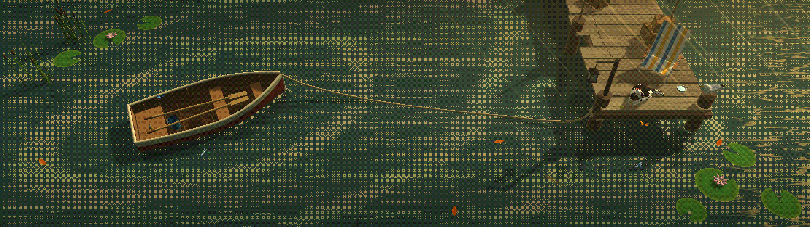
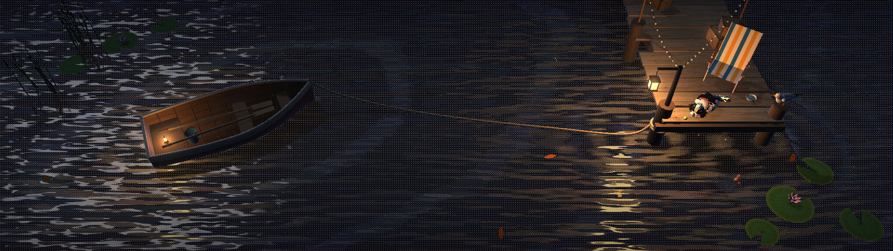

# Lago do Loki

Papel de parede animado para dois monitores, em estilo pixel/pontilhado (dithering): um barquinho amarrado por uma corda a um píer, onde o Loki — um Shih Tzu preto e branco — descansa ao lado de uma cadeira de praia.




## O que ele faz

- **Hora real:** a luz segue o relógio do PC, com o nascer e o pôr do sol de verdade de Vila Velha (ES) e a fase da lua.
- **Clima real:** chuva, nuvens, vento e neblina vêm do [Open-Meteo](https://open-meteo.com/). Quando a chuva aperta, a gaivota e os bichos vão embora voando.
- **Vida no lago:** peixes e uma carpa nadando por baixo, libélulas e borboletas, vitórias-régias, folhas que contornam o barco, vaga-lumes à noite e uma estrela cadente de vez em quando.
- **Loki:** respira, abana o rabo, acompanha os bichos com a cabeça, se espreguiça e dorme à noite. Tem coleira com plaquinha, bolinha e potinho com o nome dele.
- **Gaivota:** fica no poste, vira a cabeça e às vezes bate as asas.
- **Aconchego:** varal de luzinhas, lampião no píer, lamparina no barco, uma longneck e um cinzeiro na cadeira.
- **Datas especiais:** Natal, Ano-Novo (com fogos refletidos na água), aniversário, Halloween e Festa Junina.
- **Painel opcional:** relógio, clima, agenda, lembretes (via Gist do GitHub) e a música que está tocando.

## Instalar no Lively Wallpaper

1. Baixe `dist/Lago Pontilhado (Lively).zip`.
2. Arraste o zip para dentro do [Lively Wallpaper](https://www.rocksdanister.com/lively/).
3. Em **Personalizar**, escolha a parte da cena de cada monitor: **Esquerda (barco)** no monitor 1 e **Direita (píer)** no monitor 2. Para um monitor só, use **Cena inteira**.

Também dá pra abrir `dist/avulsos/tela1.html` e `tela2.html` em qualquer navegador. Já `dist/preview.html` tem uma barra para testar qualquer horário, chuva e tempestade.

## Opções (Personalizar)

| Opção | O que muda |
|---|---|
| Tamanho do pixel | Pequeno (1 px), Médio (2 px, mais leve) ou Grande (3 px, bem leve) |
| Quadros por segundo | 30 por padrão, em sincronia com a taxa do monitor; 60 deixa mais fluido, mas usa o dobro da placa de vídeo |
| Cadeira e o Loki | Liga e desliga o píer com o cachorro |
| Bichos no lago | Peixes, libélulas e borboletas |
| Datas especiais / aniversário | Decorações por data (aniversário no formato dia/mês) |
| Clima real | Usa o tempo de verdade de Vila Velha |
| Água reage à música | As ondas pulsam com o som do PC |
| Painel | Relógio, clima, agenda, lembretes e música, no canto que você escolher |

## Desempenho

- A água é desenhada em duas etapas: as ondas, a sombra e o reflexo em meia resolução, e só os pontinhos e brilhos finos na resolução cheia.
- O reflexo e as sombras são atualizados em quadros alternados.
- O mapa de sombras cobre apenas a área visível de cada monitor.
- O relógio da cena nunca dá saltos, nem depois de uma pausa do Lively nem com o PC ligado por dias.

## Como gerar

Precisa só de Python 3:

```
python3 build.py
```

O comando lê `src/` (código da cena e página) e `vendor/three.min.js` ([Three.js](https://threejs.org/) r158, licença MIT) e gera tudo em `dist/`.

## Estrutura

```
src/main.js        cena 3D, animações, água e pontilhado
src/template.html  página e painel
src/thumbnail.jpg  miniatura do Lively
vendor/            Three.js r158
build.py           gera dist/
dist/              pacote do Lively, páginas avulsas e prévia
docs/              imagens deste README
```
